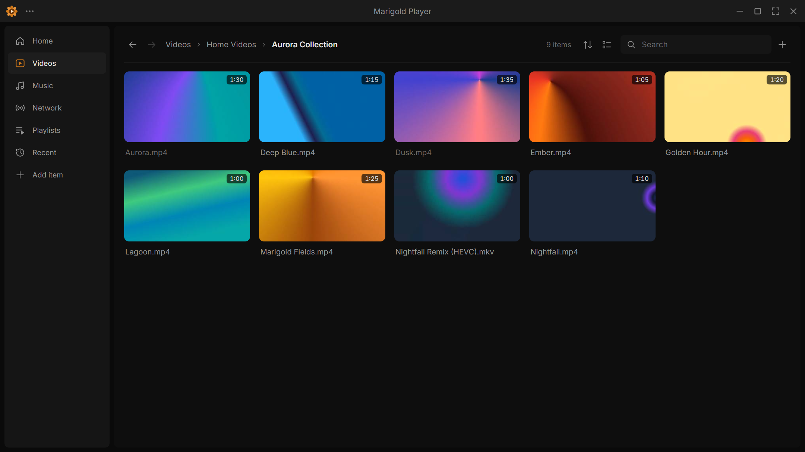
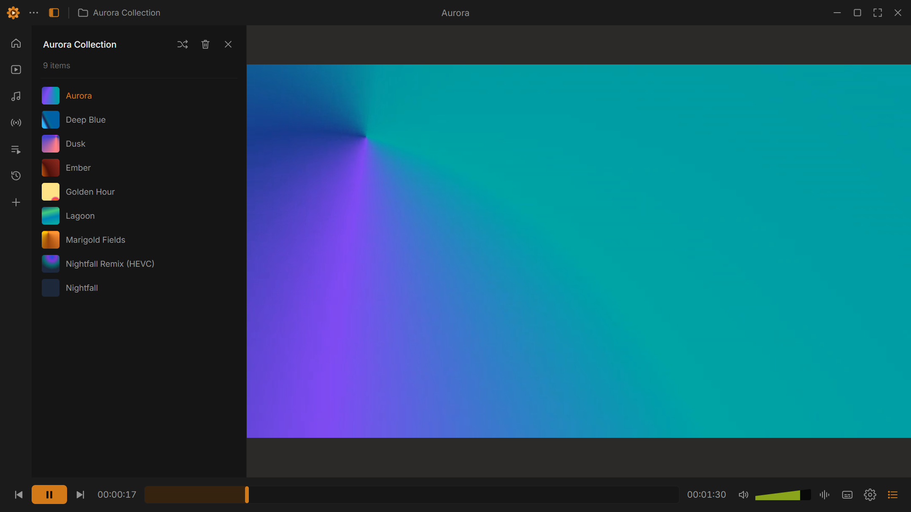
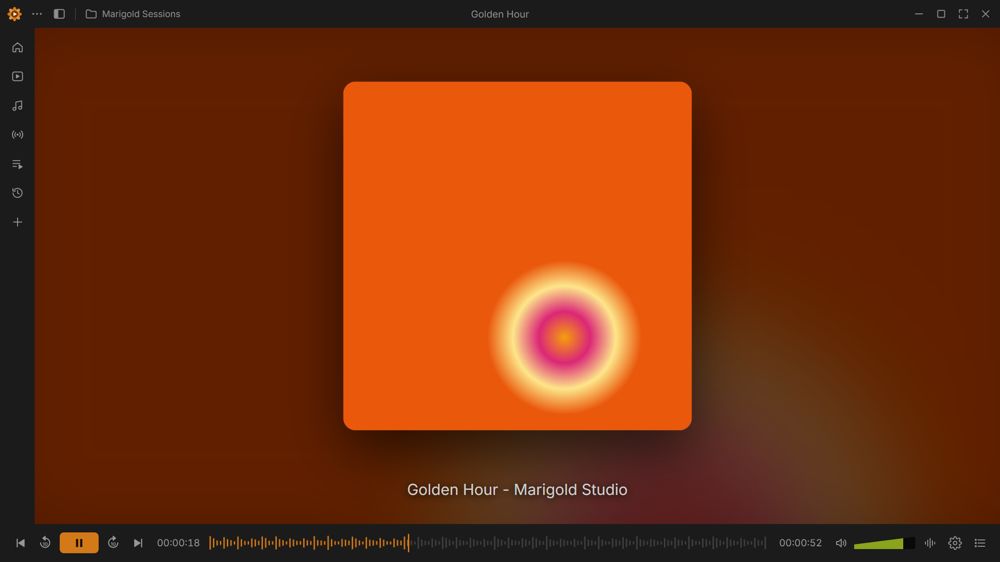
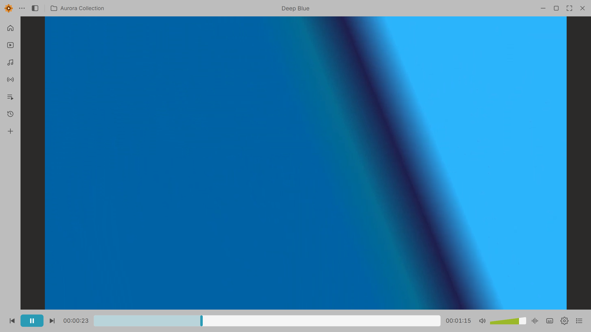

# Marigold Player

A calm, orange-accented desktop media player for video and music. It plays almost any format, remembers where you stopped, and lets you rearrange the controls to suit you.

> Marigold Player is an independent project. It is not affiliated with or endorsed by VideoLAN or the VLC project. The interface is inspired by a community redesign concept shared on Figma.

<p align="center">
  
  
  
  
</p>

## Download

Grab the installer for your system from the [latest release](https://github.com/furyengi/marigold-player/releases/latest):

| System  | File |
| ------- | ---- |
| Windows | `Marigold-Player-Setup-x.y.z-x64.exe` (installer) or `Marigold-Player-x.y.z-portable-x64.exe` (no install) |
| macOS   | `.dmg` for Intel (`x64`) or Apple Silicon (`arm64`) |
| Linux   | `.AppImage` or `.deb` |

The builds are not code-signed yet, so your OS will warn you the first time:

- **Windows** – SmartScreen: *More info → Run anyway*.
- **macOS** – right-click the app → *Open*, or run `xattr -cr "/Applications/Marigold Player.app"` once.
- **Linux** – `chmod +x` the AppImage and run it.

## Updates

Marigold Player can update itself. Open **Menu → Check for updates** (or Settings → General → Updates): it shows what is new, downloads the new version in the background with a progress bar, and installs it when you press *Restart and install*. A dot on the menu button tells you when an update is waiting, and the app checks quietly at startup (you can turn that off).

| Build | Update |
| ----- | ------ |
| Windows installer | In the app |
| Linux AppImage | In the app |
| Windows portable, Linux .deb, macOS | Shows the new version and opens the download page (macOS can only install updates in place once the app is code-signed) |

Versions before 0.3.0 have no updater, so install 0.3.0 once by hand.

## What it plays

Files the browser engine understands (H.264, VP8/VP9, AV1, AAC, MP3, FLAC, Opus, Vorbis, WAV in MP4, WebM, MKV, MOV, Ogg…) play directly. Everything else is handled by a bundled **FFmpeg**, which converts it on the fly while you watch:

| What the file contains | How it plays |
| ---------------------- | ------------ |
| H.264/AAC/MP3/FLAC/Opus in MP4, MKV, WebM, MOV | Directly, untouched |
| HEVC / H.265, 10-bit H.264, Xvid/DivX, WMV, MPEG-2, VC-1… | Video converted to H.264 |
| AC-3, E-AC-3, DTS, WMA, APE… audio | Audio converted to AAC |
| AVI, FLV, MPEG-TS, M2TS, ASF, VOB, RealMedia… | Re-wrapped, converted only if needed |

You can also switch audio tracks, show subtitles stored inside the file (SRT/ASS/WebVTT/mov_text), and see chapters. Image-based subtitles (Blu-ray PGS, DVD) and DRM-protected discs are not supported, and HLS/DASH network streams are not yet either.

Converting is real-time work, so a very heavy file (4K HEVC on an old laptop) may stutter; Settings → Playback → *Conversion quality* trades picture quality for CPU use.

## Features

- **Library** – video and music folders as thumbnail grids or lists, sorting (name, date, size, duration, last played), search, watch progress and "continue watching".
- **Player** – click to pause, double-click for fullscreen, hover seek preview, A-B loop, sleep timer, bookmarks, favorites, snapshots, picture-in-picture, recording to WebM, shuffle/repeat, a queue sidebar (left or right) and a draggable mini player.
- **Customizable layout** – drag any of ~45 buttons into the top bar and control bar, and rebind every keyboard shortcut.
- **Effects** – 10-band equalizer with presets, compressor, spatializer, stereo widener and loudness normalizer; picture brightness, contrast, saturation, hue, gamma, crop, rotate, flip, zoom and colour filters.
- **Music view** – embedded cover art, blurred backdrop and a waveform seek bar.
- **Subtitles** – picks up `.srt`, `.vtt`, `.ass` files next to the video, and can attach subtitle files to a whole folder, playlist or queue by name or episode number.
- **Playlists, history, resume**, network streams (direct http/https links), drag & drop, media keys, "Open with…".
- **Themes** – dark, light or system, with nine accent colors.

Press **F1** in the app for every shortcut.

## Privacy

No telemetry or accounts. The app only uses the network for streams you open yourself and, if you turn it on, a check for new versions on GitHub. Everything else stays on your computer.

## Develop

Requires Node.js 20+.

```bash
npm install
npm start
```

```
main.js          Electron main process: window, file access, local media server
engine.js        FFmpeg compatibility engine (probe, convert, thumbnails, embedded subtitles)
preload.js       the small bridge exposed to the page as window.native
src/index.html   app shell
src/css/         theme tokens, layout, views, dialogs
src/js/          player core, library, views, dialogs (plain ES modules, no bundler)
assets/          logo, idle artwork, fonts
scripts/         icon generator and the CI build script
```

## Build installers

```bash
npm run icon       # re-render build/icon.png from assets/logo.svg (only when the logo changes)
npm run dist       # installers for the OS you are on, written to dist/
```

### Publishing a release

Pushing a version tag builds Windows, macOS (Intel and Apple Silicon) and Linux installers on GitHub Actions and attaches them to a release:

```bash
npm version patch          # or minor / major – bumps package.json and creates the tag
git push --follow-tags
```

## Licenses

Marigold Player's code is [MIT](LICENSE). The installers also contain third-party software, most importantly a **GPL v3 build of FFmpeg** that runs as a separate program; see [THIRD_PARTY_NOTICES.md](THIRD_PARTY_NOTICES.md) for details and source locations.
